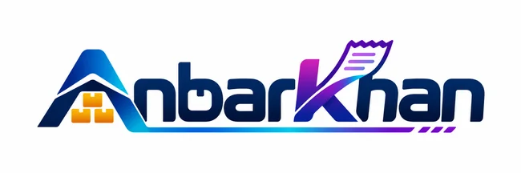
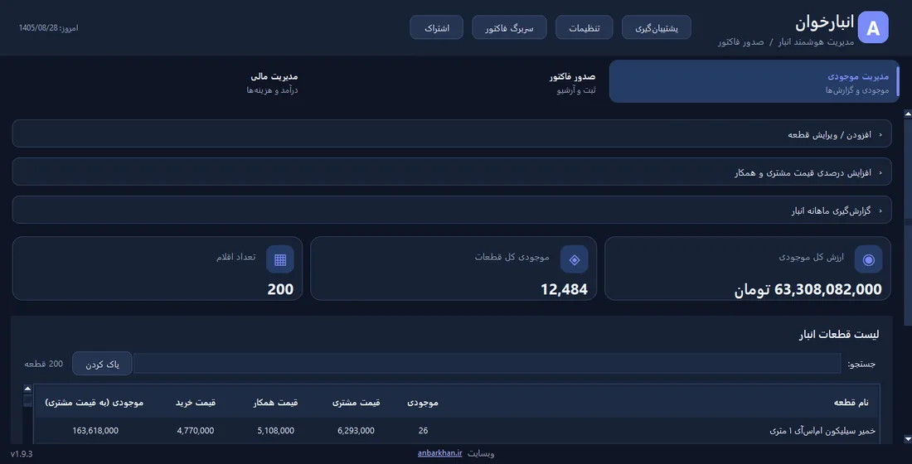
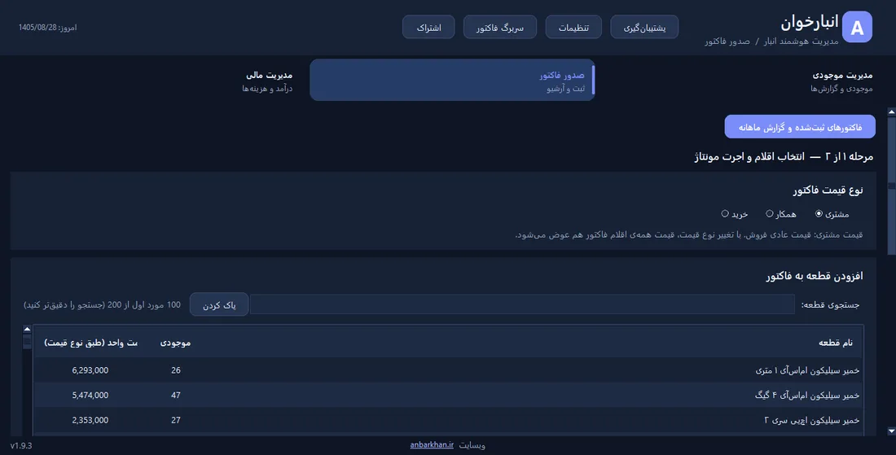
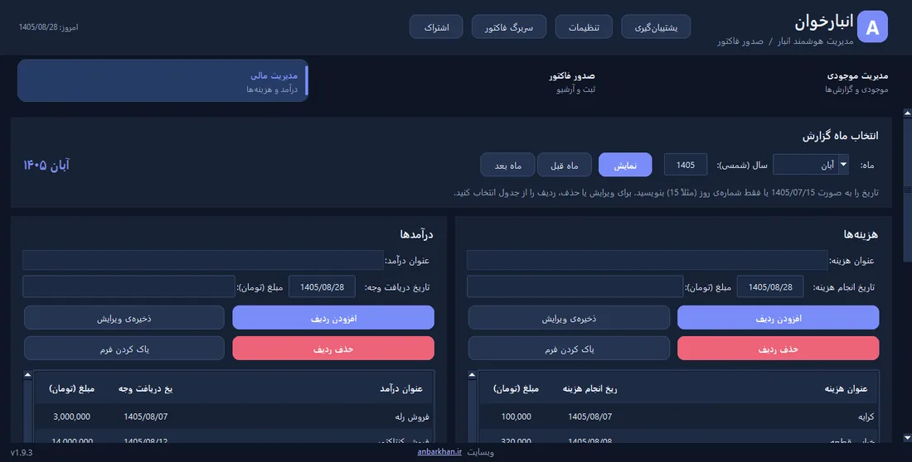

# AnbarKhan | انبارخوان

**Inventory. Invoices. A clearer view of your business.**

**مدیریت موجودی، فاکتور و گزارش‌های کسب‌وکار در یک محیط فارسی**

Windows 10 & 11 · فارسی / RTL · Product version 1.9.3

[Website / وب‌سایت](https://anbarkhan.ir) · [Downloads / دانلود](docs/DOWNLOADS.md) · [User guide / راهنما](docs/GETTING_STARTED.md) · [Support / پشتیبانی](SUPPORT.md)

**A product of [Codiator Studio](https://codiator.ir)**

---

## فارسی

انبارخوان نرم‌افزار تجاری انبارداری و فاکتورزنی برای ویندوز است؛ از ثبت کالا و کنترل موجودی تا صدور فاکتور، پیش‌فاکتور و گزارش‌های ماهانه، کارهای روزمره را در محیطی فارسی و راست‌به‌چپ کنار هم قرار می‌دهد.

### امکانات اصلی

| بخش | کاربرد |
| --- | --- |
| انبار و موجودی | ثبت و ویرایش کالا، جست‌وجو، اصلاح تعداد و گزارش گردش موجودی |
| سه سطح قیمت | نگهداری قیمت خرید، مشتری و همکار و انتخاب نوع قیمت در فاکتور |
| فاکتور و پیش‌فاکتور | ثبت اسناد، آرشیو فاکتور و خروجی PDF و Excel؛ پیش‌فاکتور بدون کاهش موجودی |
| گزارش‌های مالی | ثبت درآمد و هزینه، گزارش ماهانه و مشاهده سود |
| پشتیبان‌گیری | خروجی و درون‌ریزی Excel و پشتیبان دیتابیس |
| تجربه کاربری | تاریخ شمسی، ورودی فارسی و انگلیسی، تم روشن و تاریک |

### شروع کار

۱. [راهنمای دانلود](docs/DOWNLOADS.md) و نیازمندی‌های ویندوز را بخوانید.
۲. پیش از ارتقا از اطلاعات خود پشتیبان بگیرید و نصاب رسمی را نصب کنید.
۳. برای فعال‌سازی، شناسه دستگاه را فقط در مسیر رسمی پشتیبانی یا ربات رسمی ارسال کنید.
۴. کالا و قیمت‌ها را ثبت کنید و نخستین فاکتور خود را بسازید.

**این مخزن برای معرفی محصول، مستندات و انتشار بسته‌های نصب است. کد برنامه و ابزارهای صدور لایسنس در این مخزن منتشر نمی‌شوند.**

## Application preview / نمای محیط برنامه

تصاویر رسمی نسخه ویندوز؛ داده‌ها و مبالغ نمایشی هستند و قیمت اشتراک را نشان نمی‌دهند. این تصاویر از گالری رسمی محصول استفاده شده‌اند.

Official Windows application screenshots, also used on the product website. Shown records and amounts are sample data, not subscription prices.

### Inventory / مدیریت موجودی

### Invoicing / صدور فاکتور

### Finance / مدیریت مالی

## English

AnbarKhan is commercial inventory management and invoicing software for Windows, designed around a Persian, right-to-left workflow. Manage products, stock, invoices, pro forma invoices and monthly financial records in one desktop application.

| Capability | What it helps you do |
| --- | --- |
| Inventory | Maintain product records, search stock, adjust quantities and review stock movements |
| Pricing | Keep separate purchase, retail and partner prices |
| Invoicing | Create invoices and pro forma invoices, archive documents and export PDF or Excel |
| Finance | Record income and expenses and review monthly financial reports |
| Backups | Export and import Excel files and back up the application database |
| Desktop experience | Persian calendar, RTL input and light or dark themes |

**Requirements:** Windows 10 or 11. The installer includes the runtime; a separate Python installation is not required. The application interface is Persian; this repository provides English and Persian documentation.

This repository hosts product information, documentation and approved installer releases. AnbarKhan is proprietary commercial software. Its source code and license-issuance tools are not distributed here. A public repository does not grant an open-source license to the application or its branding.

## Documentation / مستندات

| Resource | Link |
| --- | --- |
| Installation, upgrades and activation / نصب، ارتقا و فعال‌سازی | [Getting started](docs/GETTING_STARTED.md) |
| Versions and download availability / نسخه‌ها و وضعیت دانلود | [Downloads](docs/DOWNLOADS.md) |
| Product changes / تغییرات محصول | [Changelog](CHANGELOG.md) |
| Direction and priorities / مسیر توسعه | [Roadmap](ROADMAP.md) |
| Questions and issue reports / پرسش و گزارش مشکل | [Support](SUPPORT.md) |
| Private vulnerability reporting / گزارش محرمانه امنیتی | [Security policy](SECURITY.md) |

---

**Official website:** [anbarkhan.ir](https://anbarkhan.ir) · **Support:** [@anbarkhanir](https://t.me/anbarkhanir) · **Official bot:** [@codiatorbot](https://t.me/codiatorbot)

© Codiator Studio. All rights reserved. / تمامی حقوق محفوظ است.
